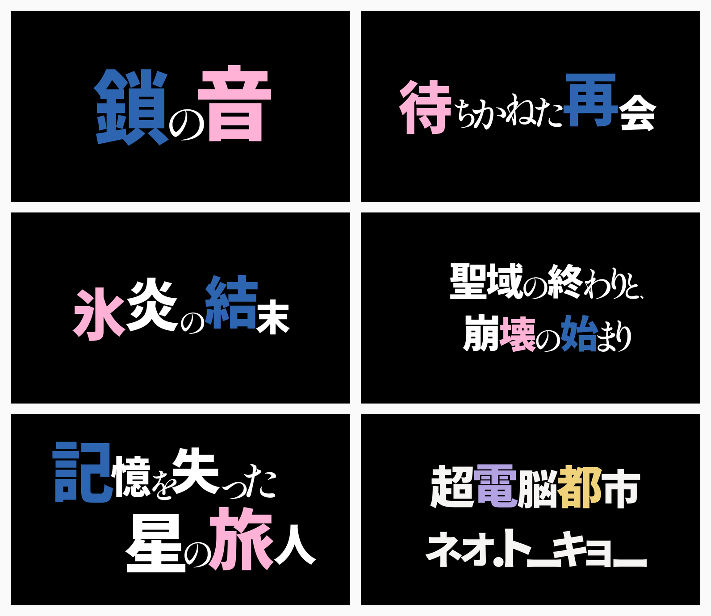
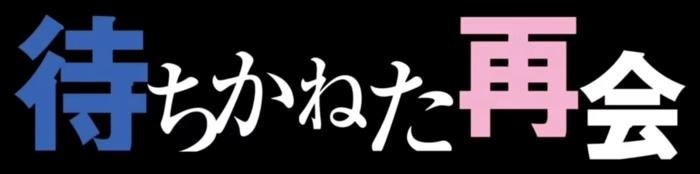
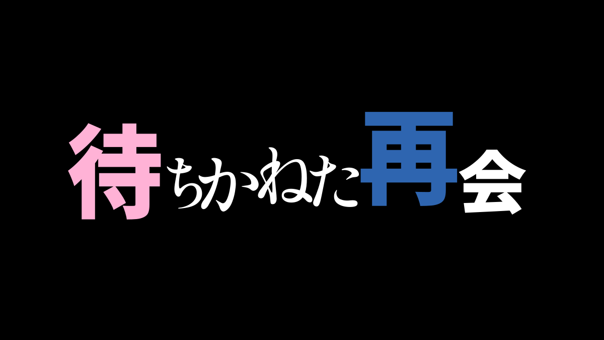

# Title Lab

日文风格化标题排版工具。输入一句话，选择字体，生成多张不同构图的标题，导出 PNG 或轮廓 SVG。

[效果展示](docs/gallery.md) · [使用说明](docs/user-guide.md) · [部署](docs/deployment.md) · [文档](docs/README.md)



这里选了 6 张生成结果，字形位置和颜色都由引擎生成。[查看原图、下载文件和生成设置](docs/gallery.md)。

## 能做什么

- 一次生成 4、6 或 8 张候选，组合不同断行、字号层级、字距和行间错位。
- 汉字与假名分别选择字体，内置 8 款开放字体，也支持上传 TTF / OTF。
- 选择预设配色或自定义强调色，按字符位置改色；重复出现的字可以分别设置。
- 导出 PNG、轮廓 SVG 和参数 JSON，支持透明背景、自定义画布和黑白底。界面也可切换 Day / Night。

支持中文汉字转为日文字形；需要把整句中文译成日语时，可启用模型翻译后再排版。

## 快速启动

本地运行使用 Python 3.12、Node.js 24，以及 Cairo、FreeType。Ubuntu 系统依赖为 `libcairo2 libfreetype6`。

```bash
git clone https://github.com/thekfjie/jp-title-lab.git
cd jp-title-lab
python3 -m venv .venv
.venv/bin/pip install -r requirements.txt
npm ci
npm run build:browser
OPENBLAS_NUM_THREADS=1 .venv/bin/uvicorn web.app:app --host 0.0.0.0 --port 8000 --workers 1
```

打开 <http://localhost:8000>。选择 A 即可生成，不需要模型密钥或原始参考截图。

也可以用 Docker：

```bash
docker compose up --build
```

服务端配置、API 和管理员私有字体见[部署说明](docs/deployment.md)。

## A 和 B 怎么选

| 模式 | 如何处理标题 | 需要模型服务 |
| --- | --- | --- |
| A · 传统算法 | 用日文分词和规则决定强调，再搜索布局 | 否 |
| B · 语义规划 | 模型分析分词、重点和布局建议，再交给同一引擎生成 | 是 |

两种模式在同一运行端共用字体、排版引擎与约束。B 不直接画图，也不保证比 A 更好。先用 A，觉得重点不合适时再比较 B 的候选。

启用 B：复制 [.env.example](.env.example) 为 `.env`，填写 `LLM_BASE_URL`、`LLM_MODEL`、`LLM_API_KEY`。Docker Compose 会读取该文件；直接运行 uvicorn 时，需要将这些变量注入服务进程。支持兼容的 Chat Completions 和 Responses 接口，详见 [B 的配置与流程](docs/llm_pipeline.md)。

## 与原作对照

| 原作参考：待ちかねた再会 | 本项目生成：B 候选 |
| --- | --- |
|  |  |

原作来自提供的《Re:ゼロから始める異世界生活》截图，版权归原权利人。B 图复用此前模型返回的分析结果。[查看三组原作 / A / B 对照](docs/gallery.md#原作参考--a--b)。

## 字体与导出

预置字体的来源和许可证保存在[字体目录](assets/open-fonts/catalog.json)。仓库与镜像只包含清单中的 SIL OFL 字体，不包含商业字体。

上传字体需自行确认使用权。浏览器版将字体保留在本机内存；Python 上传接口使用隔离会话和临时目录，默认一小时后清理，不提供字体下载接口。详见[字体管理](docs/font_security.md)。

SVG 中的文字已转为字形轮廓，接收文件的人不需要安装同款字体。透明导出可直接叠加到其他画面。

## 还有哪些不足

长句和复杂多行的效果还不稳定，自动着色也可能选错位置。可以先挑一张构图合适的候选，再调整局部颜色。发光、倒影和破损纹理暂不支持。

[效果页](docs/gallery.md)保留了同题原作对照，也说明了生成图与原作的差距。

## 开发

| 目录 | 内容 |
| --- | --- |
| `engine/` | 分词、字形处理、布局搜索与渲染 |
| `baseline/`、`llm/` | A、B 入口和语义规划 |
| `web/` | Web 界面与 Python API |
| `config/` | 布局、评分和配色参数 |
| `docs/` | 使用、部署和效果展示 |

[开发说明](docs/development.md)包含测试与展示图复现方法。参考标注、评估结果和未进入正式引擎的方案统一放在[研究记录](docs/research/README.md)。
