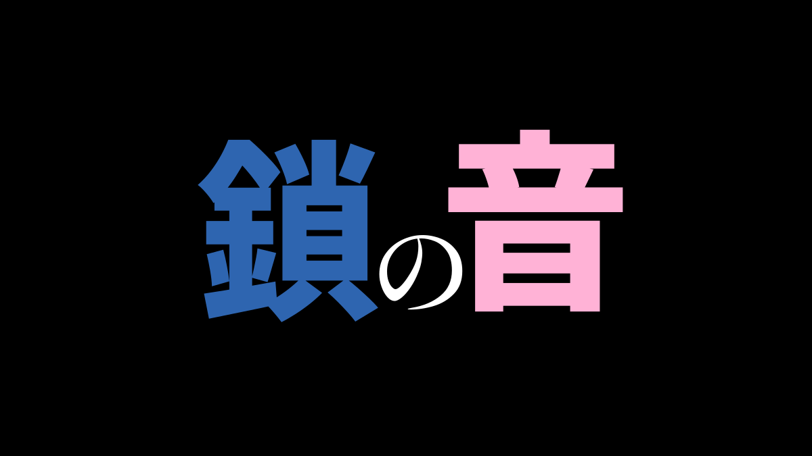
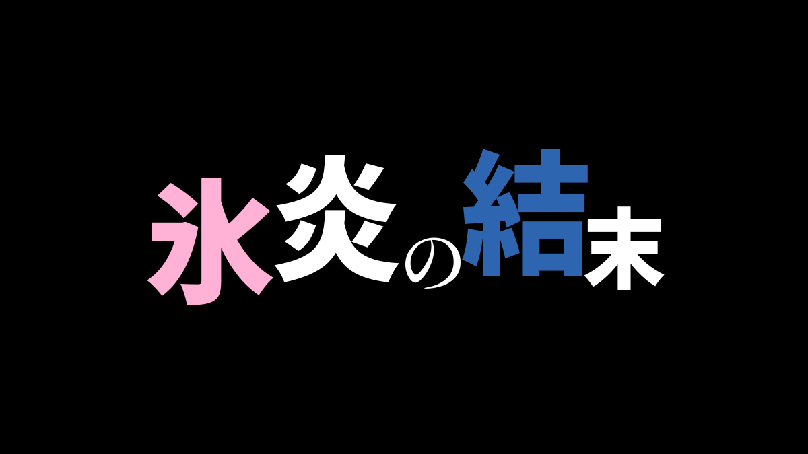
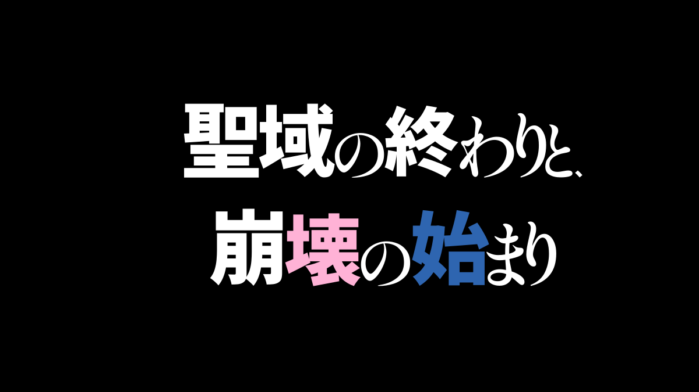
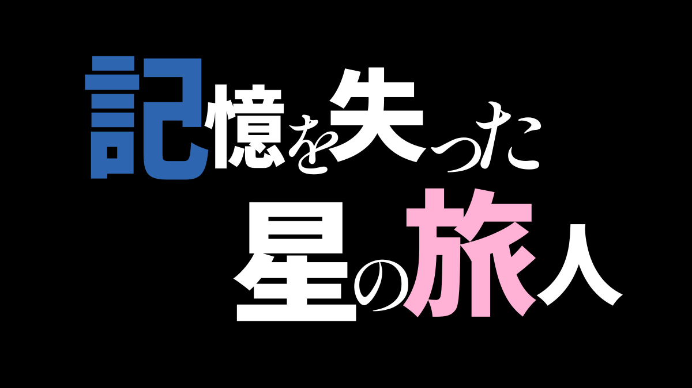
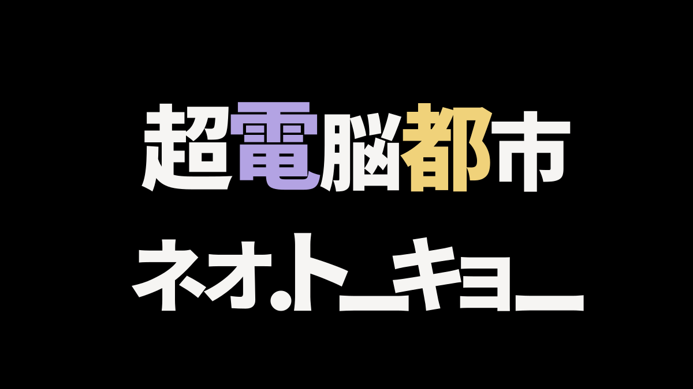
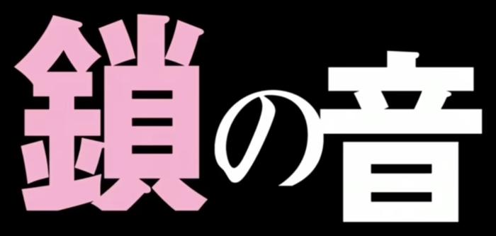
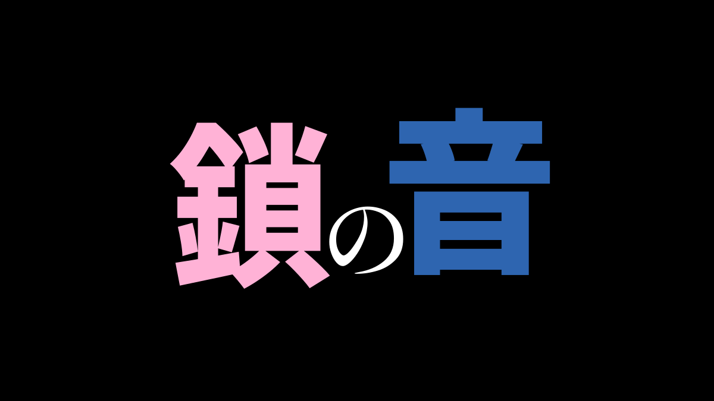
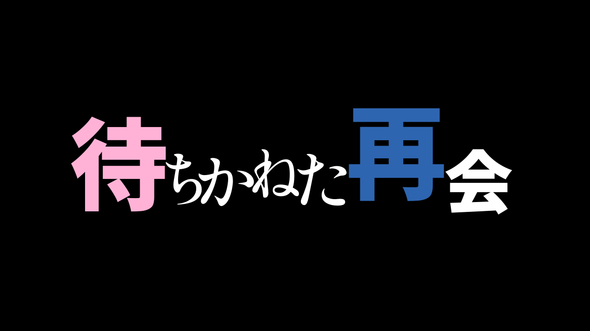
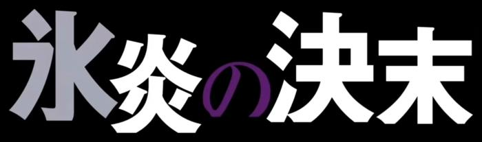
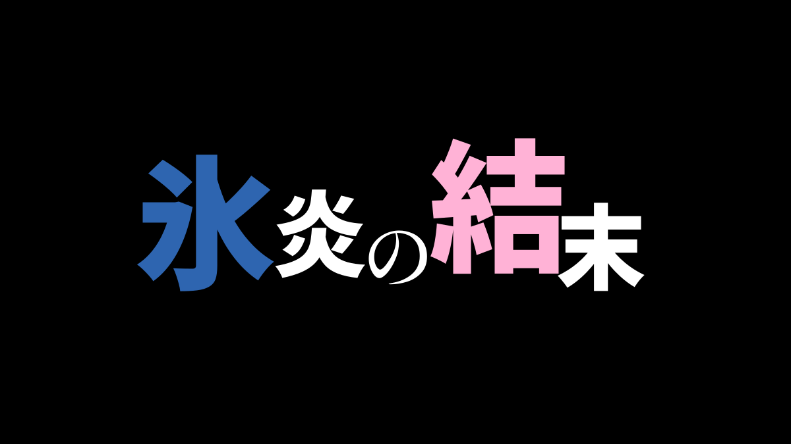

# 效果展示

这些图片用当前 Python 引擎生成。每种方案先出 6 张，再从中挑选；字形坐标和局部颜色没有手动修改。第一张候选不一定最好，下面也保留了与原作的差距。

## 精选生成图

| 鎖の音 · A | 待ちかねた再会 · B |
| --- | --- |
|  |  |
| [PNG](assets/showcase/b01-A.png) · [SVG](assets/showcase/b01-A.svg) | [PNG](assets/showcase/b03-B.png) · [SVG](assets/showcase/b03-B.svg) |

| 氷炎の結末 · A | 聖域の終わりと、崩壊の始まり · A |
| --- | --- |
|  |  |
| [PNG](assets/showcase/b10-A.png) · [SVG](assets/showcase/b10-A.svg) | [PNG](assets/showcase/b14-A.png) · [SVG](assets/showcase/b14-A.svg) |

| 記憶を失った星の旅人 · A | 超電脳都市ネオ・トーキョー · A |
| --- | --- |
|  |  |
| [PNG](assets/showcase/b15-A.png) · [SVG](assets/showcase/b15-A.svg) | [PNG](assets/showcase/b20-A.png) · [SVG](assets/showcase/b20-A.svg) |

后面三个标题是新增输入，没有对应原作图。透明输出示例：[PNG](assets/showcase/b15-A-transparent.png) · [SVG](assets/showcase/b15-A-transparent.svg)。

## 原作参考 / A / B

左列是用户提供的《Re:ゼロから始める異世界生活》标题截图裁剪，右侧两列才是本项目生成。同一行的 A/B 使用相同文本、字体、Seed、画布和配色设置，分别从各自 6 张候选中选择。

### 鎖の音

| 原作参考 | A · 传统算法 | B · 语义规划 |
| --- | --- | --- |
|  |  |  |

大字夹小假名的关系相近，原作的“鎖”更高、更密；生成结果的强调色位置和色相不同。

### 待ちかねた再会

| 原作参考 | A · 传统算法 | B · 语义规划 |
| --- | --- | --- |
|  |  |  |

B 在这一例中把“待”和“再”作为色点，位置更接近原作，但两种色相颠倒，连续假名的起伏与嵌入也还不同。

### 氷炎の結末

| 原作参考 | A · 传统算法 | B · 语义规划 |
| --- | --- | --- |
|  |  |  |

生成图保留了大小变化，但没有复现原作的灰色“氷”和紫色“の”。这也是自动强调仍有局限的例子。

裁剪只展示标题区域，缩略图不用于比较原画布留白。[来源记录](assets/references/sources.json)保留参考编号和文件哈希。原作图像版权归各自权利人，不能当作项目生成素材。

## 生成设置

| 设置 | 值 |
| --- | --- |
| 运行端 | 正式 Python 引擎 |
| 汉字 / 片假名字体 | Noto Sans JP Black，900 |
| 平假名字体 | Shippori Mincho SemiBold，600 |
| 输入 Seed | 42 |
| 画布 | 1200 × 675，黑底 |
| 着色 | 双色强调，无局部覆盖 |
| 配色 | 蓝 / 粉；“超電脳都市…”使用紫 / 黄 |
| 选图 | 前三条 A/B 各选候选 1；“聖域…”选 A-3，“記憶…”选 A-2，“超電脳都市…”选 A-4 |

B 复用了此前真实 API 调用得到的语义计划。本次展示图生成不请求模型，也不把计划重放时间当成模型响应时间。

[完整配置](assets/showcase/recipes.json) · [布局与产物清单](assets/showcase/manifest.json) · [一条命令复现](development.md#更新展示图)

本页是精选展示。要查看完整测试集与失败结果，请到[研究记录](research/README.md)。
