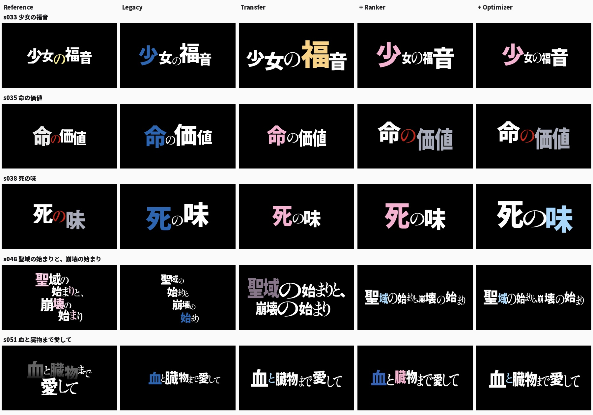

# 16 张参考的最小闭环

2026-10-12。已实际运行 Reference Transfer → 线性 Pairwise Ranker → Simulated Annealing → Top-6，并与 legacy 对照。**闭环可运行，但本轮图片尚未稳定超过 legacy，保留为独立实验，未替换线上默认引擎。**

## 直接运行

依赖沿用项目的 `requirements.txt`，没有增加 sklearn、PyTorch 或模型 API。已经保存训练模型和参考标注，无需原始截图即可生成。

```bash
.venv/bin/python -m experiments.minimal_reference_loop \
  --text '聖域の終わりと、崩壊の始まり' \
  --seed 42 --transparent --out /tmp/title-output
```

六个 PNG、六个轮廓 SVG 和复现参数写入 `/tmp/title-output/custom/`。可用 `--kanji /path/a.ttf --kana /path/b.otf` 使用自己的字体。`--seed` 只改变生成搜索，训练难例的 seed 固定在配置中。实验 CLI 支持 1–120 字的单条无空白标题；缺字会报错，不能生成六个不同且合法的候选时也会报错。

重跑完整闭环：

```bash
OPENBLAS_NUM_THREADS=1 .venv/bin/python -m experiments.minimal_reference_loop \
  --ranker --benchmark --diagnose
python3 -m http.server 8768 --directory experiments/minimal-reference-loop
```

打开 `http://localhost:8768/`，查看原图、四个阶段各六张候选、同一候选的优化前后以及 PNG/SVG。`blind.html` 随机排列四种方法，点击后才显示方法名；它是人工查看工具，本轮没有独立评审数据。参数入口是 [minimal_reference_loop.yaml](../config/minimal_reference_loop.yaml)。

`--out` 可指定完整实验目录。只生成新标题时，模型默认来自仓库保存的目录；用 `--model-dir` 指定其他模型目录。在同一次调用中加 `--ranker --text` 会使用该次训练的模型。

## 参考表示与标注

固定 16 张：001、002、005、006、010、011、014、018、024、030、033、035、038、048、051、079。共 **76 个 Visual Groups、110 个字符位置**，覆盖 1/2/4 行、单字锚点、连续假名、重复结构、不同出现位置的色点、灰色主体和全片假名。不是从 82 张自动取前 16 张。

来源为 [minimal_annotation_source.json](../references/minimal_annotation_source.json)，成品为 [minimal_visual_groups.json](../references/minimal_visual_groups.json)。分组通过原图视觉检查、连通域归属和粘连边界校正建立。16 张分组框叠图保存在 `experiments/minimal-reference-loop/annotations/`。

以下是 `s030` 的结构摘要；完整文件另有归一化 XYXY、原图像素框、行号、相邻依附关系与边界误差：

```json
{
  "id": "s030",
  "text": "待ちかねた再会",
  "groups": [
    {"text": "待", "kind": "kanji", "start": 0, "end": 1,
     "glyphs": [{"text": "待", "start": 0, "color": "#3863b2", "color_role": "accent"}]},
    {"text": "ちかねた", "kind": "kana", "start": 1, "end": 5,
     "glyphs": [{"text": "ち", "start": 1, "ink_bbox": null},
                {"text": "か", "start": 2, "ink_bbox": null},
                {"text": "ね", "start": 3, "ink_bbox": null},
                {"text": "た", "start": 4, "ink_bbox": null}]},
    {"text": "再", "kind": "kanji", "start": 5, "end": 6,
     "glyphs": [{"text": "再", "start": 5, "color": "#f3b3cf", "color_role": "accent"}]},
    {"text": "会", "kind": "kanji", "start": 6, "end": 7,
     "glyphs": [{"text": "会", "start": 6, "color": "#ffffff", "color_role": "base"}]}
  ]
}
```

`s048` 保留 `聖域`、`まりと、`、`崩壊` 等组内色点，不把整个组涂成一个颜色。位置按 Unicode scalar 索引记录，不以字符串替换处理重复字。

**19 个连续假名内部的字框仍未知。**它们保留 `null`，重绘时通过用户字体的 shaping 在已知组框中推断，绝不回填为实测值。字体名称与 point size 全部未知；颜色是截图可见 RGB 的近似测量，不能推断作者使用的字体或无压缩原色。

重新建立叠图需要本地 `references/originals`：

```bash
.venv/bin/python -m experiments.minimal_reference_loop --prepare
```

## 运行路径

1. Sudachi → 四种组划分：整词、字种分组、汉字拆分和连续假名连接。
2. 从参考的组类别序列、组数、字种比例、重复次数和标点数检索 Top-4。权重为 0.45/0.20/0.15/0.15/0.05。
3. 单调动态规划允许 1↔1、1↔2、1↔3 映射，不跨参考行合并。组的空间份额由真实 glyph 宽度分配。16 条查询中，每池 9–16 个合法迁移布局，全部保存在各标题的 `initial-pool.json`。
4. 共用 HarfBuzz/FreeType/轮廓 SVG Renderer。已知原字框提供高低关系，未知假名保持共同字体 scale；pair-specific 光学字距和实际 mask 用于碰撞修复。单个参考色点拆成多个目标组时只保留一个拥有者。
5. Ranker 对同一个候选池排序；8 个初始候选分别进行 96 步退火搜索。移动、缩放、整行 offset 和组内颜色交换都必须经过文字完整、禁则、可见对比度、边界和 ink 碰撞检查。
6. 保留六个不同候选。搜索只保留比其自身初始分数更高的 best，但**分数上升不代表审美改善**。

两种实验字体是 Noto Sans JP Black / Shippori Mincho SemiBold，四个阶段完全相同。字体文件只来自现有 OFL 目录或 CLI 指定路径；没有新增商业字体、字体下载接口或外部模型调用。

## Ranker 留一评估

每张 80 个负例：8 类型 ×10，合计 **1,280 对**。类型是字号、位置、连接字放大、主字缩小、配色、间距、断行和整体比例。大小扰动有五档。模型为带 L2 的 pairwise logistic：基础关系特征归一化后加入平方项，线性权重训练，无 Transformer。

16 折中，每折训练集只有其他 15 张及其 1,200 个负例；归一化参数也仅来自训练集。被查询标题同时从参考检索库删除。未见文本使用 16 张全量训练模型。生成不读取查询原图、查询断行或色位；对照指标仅在生成结束后计算。

| 指标 | 结果 |
|---|---:|
| 留一 Original > Corrupted | 91.4% |
| 真实字体重绘后仍满足硬约束的 632 个负例 | 87.7% |
| 按标题 bootstrap 95% CI | 87.7%–94.2% |
| 字号 / 位置 | 86.3% / 89.4% |
| 连接字放大 / 主字缩小 | 98.8% / 91.3% |
| 配色 / 间距 | 95.0% / 85.6% |
| 断行 / 整体比例 | 100.0% / 85.0% |

超过预先配置的总正确率 80%、合法难例 70%、各类型 70% 门槛，才进行生成搜索。结果在 `ranker-evaluation.json`；16 折模型在 `ranker-folds/`；全部扰动几何及随机种子在 `negatives.json`。

负例标签是自动扰动假设，轻微移动、缩放或换色未必更差；配色负例中存在不可见字和全彩等容易识别的情况。**95% 配色正确率不能证明学会了“该给哪个字上色”。**`ranker-qa/` 展示每个标题最难的合法负例，包括模型判断错误的案例。图片使用共同字体重绘，所列分数来自实测标注特征，两者不冒充原作像素。

## 同输入四阶段对照

16 个参考标题进行留一生成，另有 4 个无参考新标题。每条每阶段六张，共 **480 张 PNG +480 个 SVG**。优化前还单独导出与最终第一名对应的同一 initial candidate，避免把换了候选误当成优化改善。

下表只比较 16 条参考的第一候选；色位与断行是参考接近度，不是审美评分。legacy 的规则曾依据全部 82 张调整，本表不能声称它经过与新方案相同的训练留出。

| 指标 | Legacy | Transfer | + Ranker | + Optimizer |
|---|---:|---:|---:|---:|
| 原断行匹配 | 13/16 | 9/16 | 10/16 | 10/16 |
| 所有非白色位 Jaccard | 31.1% | 21.4% | 21.2% | 19.6% |
| 彩色色位 Jaccard | 15.6% | 9.4% | 18.8% | 18.8% |
| 宽高比绝对 log error 中位数，越小越近 | 0.183 | 0.286 | 0.251 | 0.238 |
| 组相对高度 log error 均值，越小越近 | 0.188 | 0.181 | 0.188 | 0.180 |

全部 480 候选无缺字、越界、禁则或文字丢失；生成与优化共同执行画布宽高 6.5% 的安全留白，原作几何重绘不强行改为这个留白。低分辨率 ink mask 碰撞比例最高 0.003，未突破配置上限。该检查不能代替全分辨率光学审查。

肉眼检查全部四张总览后，长标题经常退化成一条细长横排；少数例子如 `レム` 在字形与色点上改善，不能抵消 `始まりの終わりと終わりの始まり`、`聖域…` 等结构丢失。



## 哪一环失效

完整数字在 `diagnostics.json`，下列类型可同时发生，不相加为总失败率。

| 参考偏差，16 条第一候选 | Legacy | Transfer | + Ranker | + Optimizer |
|---|---:|---:|---:|---:|
| 断行不同 | 3 | 7 | 6 | 6 |
| 宽高比偏离超过 20% | 8 | 10 | 9 | 9 |
| 非白色位重合 <0.5 | 10 | 12 | 12 | 13 |
| 彩色色位无交集 | 9 | 10 | 8 | 9 |

**检索与迁移：**候选池只能在 11/16 条里覆盖原断行，排名又丢掉其中 1 条。`s048` 是 16 张中唯一四行参考，留出后参考库只有一/二行；迁移和本轮只移动、不改行的 optimizer 无法造出缺失结构。`s024`、`s079` 的两行结构虽在库中，Top-4 与映射仍未给出原断行。脚本结构相近不等于视觉作用相近，`絶望という病` 会出现连接假名被映射进巨大汉字槽的结果。

**评分：**真正严重的失败是，留一 ranker 在 **15/16 条上把实际生成的第一候选排在原作几何之上**。换成共同字体重绘原作后，仍只有 1/16 胜过第一候选，说明不只是原字体不同。模型能够判别原作周围的人工扰动，却不能可靠排序另一种生成分布。每条的主要得分贡献也写入诊断，便于区分分组变化、边界框重叠和几何分布变化。

**着色盲点：**6 个保持字形几何、文字与颜色数量不变的白色/彩色位置交换探针里，**5 个特征完全相同**。它们都来自 `s048`，不是六个独立标题。例如 `まりと、` 把粉色从 `り` 移到 `と`，分数完全不变。另有 13 个同色角色内部的 RGB 交换，多为灰色或白色的微小色差，只作为弱探针保留；不能与白/彩位置交换混为强证据。现有特征描述组级着色比例和颜色跳变，缺少字位置与颜色的关系。探针证明评分不敏感，不自动把任意换色认定为丑。

还存在字种与视觉角色混淆：`s010` 的强调假名 `や` 被 `kind=kana` 与普通连接假名一起处理。该条原作失分的主要贡献是两个 dependency gap 平方项；视觉锚点不应仅由汉字/假名字种定义。这是已有分组与关系特征需要修正的问题。

**优化：**同一候选的模型分数在 16/16 条上升，组高度参考偏差却在 3/16 条加重。总表中的色位下降还包含“最终第一名换成了另一个 initial candidate”的因素；相同 initial 的非白色位 Jaccard 本轮没有下降，不能混为一个结论。当前搜索在继承偏差目标，不能用退火后的高分证明闭环有效。

## 当前收口

本轮停在失败诊断，没有加新模型、新模块或新论文，没有扩展到 82 张训练，没有做 LoRA、diffusion 或改线上默认。先解决评分对着色位置及生成候选的失真，再考虑继续推进这个已有闭环。

B 的已有语义规划路线继续保留，**本轮没有将 B 接到新 ranker 上，也没有声称完成新闭环的 A/B 对比**；TextLogoLayout 独立跑分和浏览器引擎同步同样按缩小后的范围暂缓。下次接入时仍须走同一字体、约束、搜索和评分。

首轮适配修正前的摘要和总览保留在 `v0/`。当前结果保存 seed、字体/标注/配置/模型 hash、检索参考、分组方案、映射和完整搜索轨迹。关键回归覆盖色点复制、未知假名 scale、查询隔离、搜索复现、约束、同一 initial 优化对照和已知评分盲点。

验证：46 个 Python 测试、16 个 JavaScript 测试全部通过。浏览器实际验证搜索、六候选切换、SVG 下载、随机对照揭示及手机宽度无溢出；记录在 `browser-qa.json`。CLI 的透明 PNG 已检查 alpha 通道，全部 480 对图片均通过 PNG 解码与 SVG XML 解析。每条的四阶段生成及全部导出用时中位数约 4.1 秒，包含 PNG/SVG 写盘，不能当成单次在线推理延迟。
